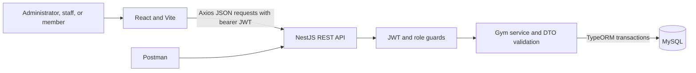
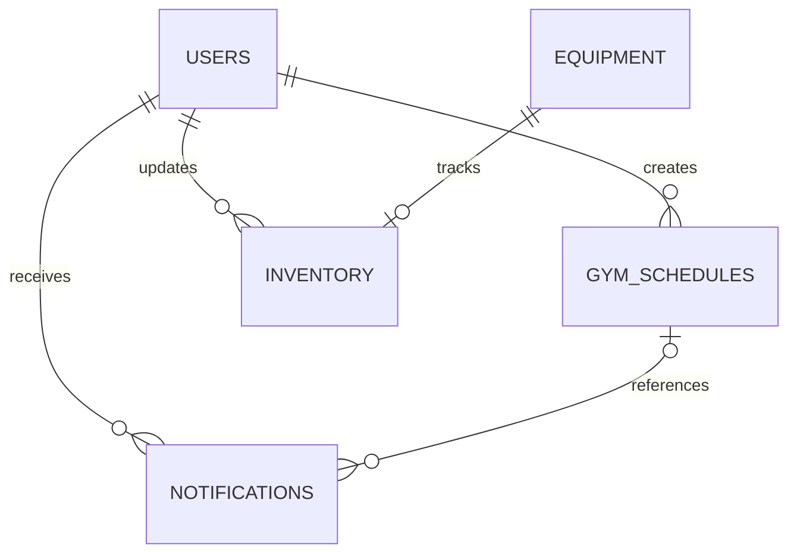

# Gym Schedule and Inventory Management System

Individual final project for ITEC 116 — Systems Integration and Architecture 2.

Gym administrators and staff use the application to manage schedules, equipment, inventory, and accounts. Members can check upcoming gym activities and equipment availability and view their personal notifications and profile.

## Run locally

Prerequisites are Node.js 22.12+ and MySQL 8.0.16+. XAMPP MariaDB can also run the project locally.

1. Start the database server. In a MySQL client or phpMyAdmin, run [database/setup.sql](database/setup.sql) to create `gym_management_db`.
2. Run the following SQL as a database administrator. Replace the example password before running it. Use the same database username and password in your environment file.

   ```sql
   CREATE USER 'gym_app'@'127.0.0.1' IDENTIFIED BY 'replace-with-a-strong-password';
   GRANT SELECT, INSERT, UPDATE, DELETE, CREATE, ALTER, INDEX, REFERENCES
     ON gym_management_db.* TO 'gym_app'@'127.0.0.1';
   ```

3. Copy [.env.example](.env.example) to `.env` in the project root. Set `DB_PASSWORD`, `JWT_SECRET`, `BOOTSTRAP_ADMIN_EMAIL`, and `BOOTSTRAP_ADMIN_PASSWORD`. Generate a secret with the following command. The administrator password must contain at least 8 characters and fit in 72 UTF-8 bytes.

   ```sh
   node -e "console.log(require('node:crypto').randomBytes(48).toString('hex'))"
   ```

4. Install the locked dependencies and start the API from the project root.

   ```sh
   npm ci
   npm run dev:api
   ```

   Startup runs the TypeORM migration and creates the administrator when there is no active administrator. Changing the bootstrap password after initialization does not reset the administrator's password. Existing administrators can change account passwords in **Users**.

5. In a second terminal, start the frontend.

   ```sh
   npm run dev:web
   ```

6. Open [http://localhost:5173](http://localhost:5173) and sign in with the administrator email and password you set. Use **Users** to create staff and member accounts.

On Windows PowerShell, use `npm.cmd` in place of `npm` if script execution is restricted.

The live workspace uses XAMPP on port 3306. An ignored local database under `.gym-db` is the retained source from before the move to XAMPP. It uses a separate data directory on port 3307. For recovery work, start that retained instance with the following command from the workspace.

```powershell
& 'C:/xampp/mysql/bin/mysqld.exe' "--defaults-file=$((Resolve-Path .gym-db/my.ini).Path)" --bind-address=127.0.0.1 --port=3307
```

## Roles and workflows

| Capability | Administrator | Staff | Member |
| --- | --- | --- | --- |
| View dashboard and personal account | Yes | Yes | Yes |
| View schedules | All | All | Scheduled and upcoming or in progress |
| Create and edit schedules | All | Create and edit own schedules | — |
| Delete schedules | Yes | — | — |
| View equipment availability | Yes | Yes | Yes |
| Create, edit, and delete equipment | Yes | — | — |
| View and update inventory | Yes | Yes | — |
| Manage suppliers | Yes | — | — |
| Create accounts, edit roles, set passwords, deactivate accounts | Yes | — | — |
| View and mark own notifications as read | Yes | Yes | Yes |

Activities share one gym schedule. Scheduled time ranges cannot overlap on the same date, and consecutive activities may share a start and end boundary. Schedule changes create in-app notifications for active users. Equipment starts with an inventory quantity of zero. Deleting equipment removes its inventory row. Account deactivation immediately revokes API access, including access through an existing token.

## Architecture





The database tables are defined by [the TypeORM entities](backend/src/entities.ts) and migrations under [backend/src](backend/src). Inventory has a unique equipment foreign key. Notifications retain their message when the referenced schedule is deleted. Schedule and booking writes use serializable transactions to protect the overlap checks from concurrent writes. Passwords are hashed with bcrypt and excluded from normal queries. The API verifies JWTs and reads the current account status and role on every authenticated request.

## REST API

Base URL is `http://localhost:3000/api/v1`. Log in with JSON containing `email` and `password`, then send the returned `accessToken` as `Authorization: Bearer <accessToken>`.

| Method | Path | Access |
| --- | --- | --- |
| POST | /auth/login, /auth/register | Public |
| GET | /auth/me, /dashboard | Authenticated |
| GET, POST | /auth/me/profile-picture | Member, own picture |
| GET, POST | /users | Administrator |
| GET | /users/:id | Administrator |
| PUT | /users/:id | Administrator, password optional on update |
| DELETE | /users/:id | Administrator, deactivates member accounts and preserves their history |
| GET | /schedules, /schedules/:id | Authenticated, results depend on role |
| POST | /schedules | Administrator, staff |
| PUT | /schedules/:id | Administrator, staff own records |
| DELETE | /schedules/:id | Administrator |
| GET | /bookings, /bookings/:id | Administrator, member own records |
| POST | /bookings | Member |
| PUT | /bookings/:id | Member, own pending request |
| DELETE, PATCH | /bookings/:id (DELETE), /bookings/:id/cancel (PATCH) | Member, cancels eligible own bookings and preserves history |
| PATCH | /bookings/:id/decision | Administrator |
| GET | /equipment, /equipment/:id | Authenticated |
| POST | /equipment | Administrator |
| PUT, DELETE | /equipment/:id | Administrator |
| GET | /inventory, /inventory/:id | Administrator, staff |
| PATCH | /inventory/:id | Administrator, staff |
| GET, POST | /suppliers | Administrator |
| GET, PUT, DELETE | /suppliers/:id | Administrator |
| GET | /notifications | Authenticated, own records |
| PATCH | /notifications/:id/read | Authenticated, own records |

Successful creates return `201`. Deletes return `204`. Invalid input returns `400`, missing or invalid credentials return `401`, and forbidden operations return `403`. Missing records return `404`, and duplicate emails or schedule conflicts return `409`.

Supplier writes accept `supplierName`, `contactPerson`, `phone`, `email`, `address`, and `status` (`ACTIVE` or `INACTIVE`). Equipment writes accept an optional `supplierId`. Omit the field to keep the current assignment, or send `null` to clear it. Existing equipment starts unassigned. Inventory returns the assigned supplier's ID and name. Deleting a supplier linked to equipment returns `409`, so reassign or clear those links first.

## Verify

Import both JSON files in [postman](postman). Select the **Gym Management Local** environment, enter the administrator credentials in its local values, then run **Gym Management API** in collection order against a disposable database. The collection captures JWTs and resource IDs and checks the expected HTTP responses.

For automated role, validation, concurrency, and persistence checks, start the API with `.env` configured for a disposable database, then run:

```sh
node scripts/smoke-api.cjs
```

Both workflows create records and deactivate their test accounts at the end. In-app notifications and deactivated accounts remain available for inspection in the database.

## Build and configure

```sh
npm run build
npm start
```

NestJS compiles into `dist/api`. Vite builds into `dist/web`. When serving the built frontend, configure your static server to serve `index.html` for client-side routes. Set `VITE_API_URL` at frontend build time if the API address changes and set `CORS_ORIGIN` on the API to the frontend origin.

Keep `.env`, local database files, and installed dependencies out of commits. The repository can be initialized with `git init` and pushed to GitHub with `package-lock.json` and `.env.example` included.
